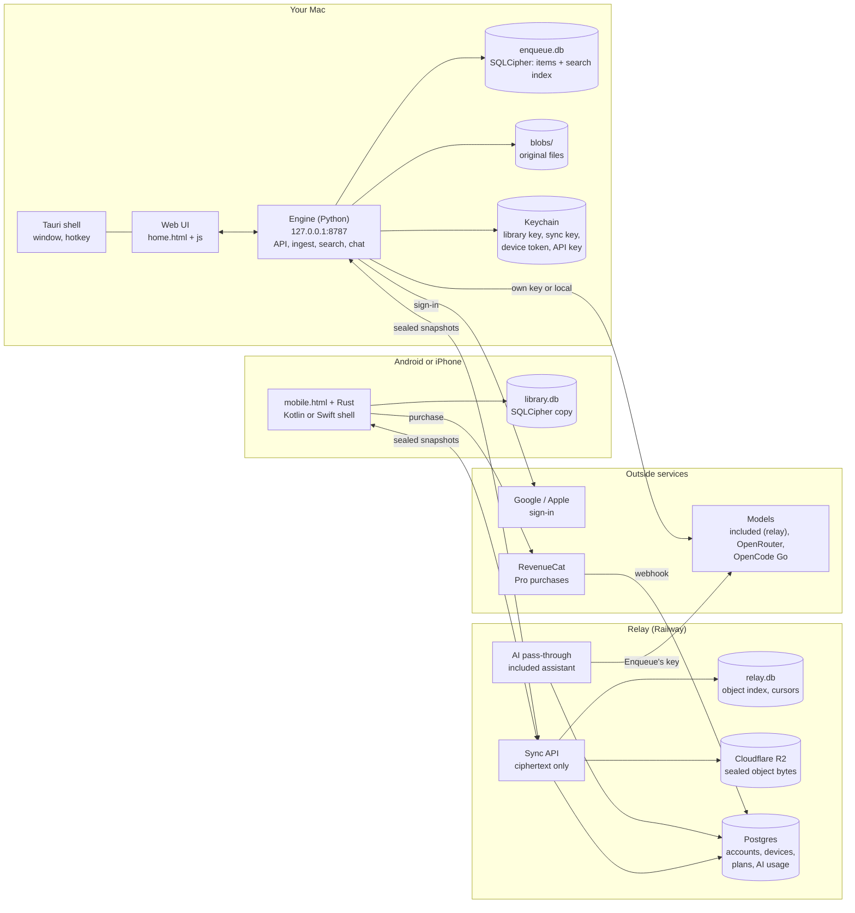
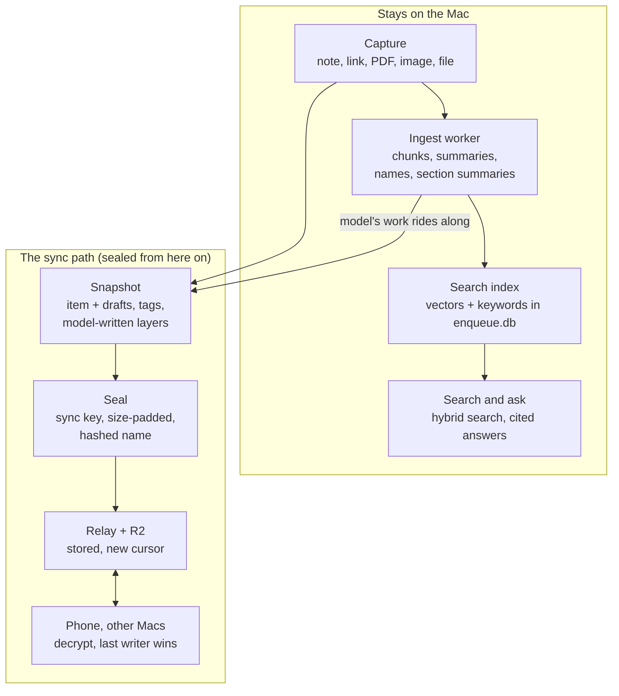
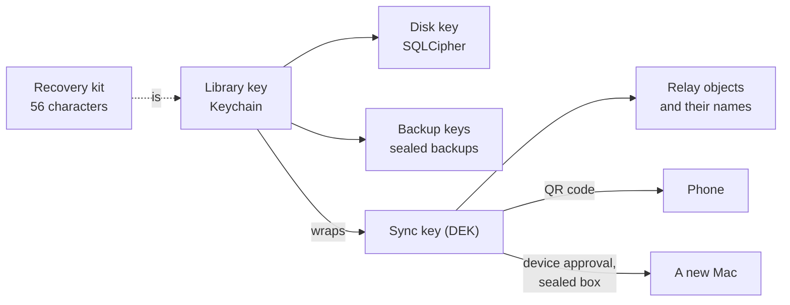

# Architecture

How Enqueue's pieces fit together and how an artifact moves through them.
For the rules each piece keeps, see [AGENTS.md](../AGENTS.md); for what a person sees, [MANUAL.md](MANUAL.md).

## The pieces

- **The Mac holds the library and does the thinking.** The engine serves the window over loopback only, keeps everything in one SQLCipher file (the items and the vector + keyword index), keeps original files in `blobs/`, and keeps every key in the Keychain.
- **The relay is a dumb, zero-knowledge mailbox.** It stores sealed bytes under hashed names, keeps a cursor per library so each device asks "what changed since N", and pushes a "something changed" stream. With R2 on, the bytes live in the bucket and `relay.db` holds only the index. It cannot open anything.
- **Accounts only say who you are.** Google or Apple sign-in gives each device its own token; Postgres holds accounts, devices, plans and the included assistant's monthly use, never a key.
- **The phone holds an encrypted copy.** It reads, captures and does light edits, asks questions over a keyword search of its copy, and never runs the model over the library. Android and iPhone share the page and the Rust; only a thin native shell differs (Kotlin on Android; Swift plugins on iOS for purchases, the Face ID lock and Quick capture).
- **Models are called from where the text is.** The Mac calls the included assistant through the relay, or a service with your own key; anything marked local-only goes to no model. Embeddings are always computed on the Mac.

## The life of an artifact

1. **Capture** writes the item and returns at once; nothing waits on a model.
2. **Ingest** cuts the text into chunks and embeds them, then (behind the capture) has the ingestion model write summary lines, the names in it, and, for a long document, a summary per section.
3. **The index** keeps every layer as vectors and keywords inside the same encrypted file, so search meets your words and your meaning.
4. **Search and ask** fuse the layers, drop what falls below the relevance floor, and answer only from passages they cite.
5. **Every write is also a snapshot**: the item with its drafts, tags, preview and the model's layers, in a fixed canonical form.
6. **Sealed** under the sync key, padded to a size bucket and named by a keyed hash, it goes to the relay, which gives it a new cursor.
7. **Other devices** pull what changed since their cursor, decrypt, and keep the newer version by `(updated_at, device)`. A delete is a snapshot like any other: it carries `deleted_at`.

The phone's own writes travel the same path the other way, and a second Mac takes the model's work from the snapshot instead of paying for it again.

## Keys

- One library key at the root; the disk and backup keys are derived from it, and it wraps the sync key.
- The phone gets the sync key by scanning the Mac's code; a new Mac gets it sealed to its own public key when a Mac that has it approves it.
- Nobody else holds any of it, so the recovery kit is the way back when every device is gone.

## Where each part is

| Part | Code |
| --- | --- |
| Shell | `desktop/src/main.rs`, `desktop/src/lib.rs` |
| Engine | `src/enqueue/` (`api/`, `ingest/`, `index/`, `retrieve/`, `sync/`) |
| Web UI | `src/enqueue/static/home.html`, `js/`, `css/` |
| Phone | `src/enqueue/static/mobile.html`, `desktop/src/sync.rs`, `desktop/gen/android/` |
| Relay | `src/enqueue/relay/` (`app.py`, `storage.py`, `blobs.py`, `accounts.py`, `ai.py`) |
| Keys | `libkey.py`, `keyring.py`, `keyring_file.py`, `crypto.py`, `sync/join.py` |
